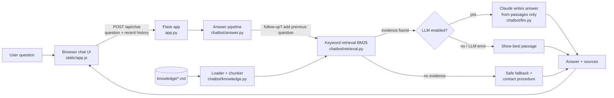

# College Information Assistant

A small, working chatbot that answers questions about a college **using only approved
Markdown files**. Built for a live, hands-on workshop.

> **Demo data notice.** "Greenfield Demo College" is fictional. Every fact in
> `knowledge/` is illustrative demo data, not information about a real institution.

What it demonstrates:

- **Understanding different phrasings.** "What departments are available?" and "Which academic programs can I choose from?" find the same fact.
- **Retrieval.** It searches the Markdown knowledge files for relevant passages.
- **Grounded answers.** It answers only from those passages. With an LLM switched on, Claude writes the answer from the retrieved text.
- **Honesty.** It says "not in the knowledge base" instead of inventing facts.
- **Source transparency.** Every answer shows the file and section it came from.
- **Conversation context.** Follow-ups such as "What about Saturday?" work within the current chat.
- **Graceful failure.** Configuration and API errors appear as readable notices; the app does not crash.

---

## Quick start

**Prerequisites:** Python 3.10 or newer. Tested with Python 3.11.7 on Windows 11.
No API key is needed for the default offline mode.

### 1. One-time setup

Windows (PowerShell):

```powershell
cd college-chatbot
python -m venv .venv
.\.venv\Scripts\python.exe -m pip install -r requirements-dev.txt
```

macOS / Linux:

```bash
cd college-chatbot
python3 -m venv .venv
.venv/bin/python -m pip install -r requirements-dev.txt
```

### 2. Launch (the one command to run before presenting)

```powershell
.\.venv\Scripts\python.exe app.py
```

(macOS / Linux: `.venv/bin/python app.py`)

Then open **http://127.0.0.1:5000**. The terminal shows how many passages were loaded
and which answer mode is active. Press `Ctrl+C` to stop.

### 3. Run the tests

```powershell
.\.venv\Scripts\python.exe -m pytest -v
```

---

## Using the chatbot

- Type a question and press **Enter** (Shift+Enter adds a new line), or click **Send**.
  You can also click one of the example questions.
- Under each answer you'll see:
  - **Source:** the file and section that supports the answer.
  - **Related:** other matching sections.
  - A chip showing whether the answer came from **Retrieval only** or **LLM + retrieval**.
- **New chat** clears the conversation. Conversation history lives only in the browser
  tab; nothing about the chat is saved on disk.
- The badge at the top right shows the real answer mode: **Offline retrieval mode**,
  **LLM: model-name**, or **LLM error → retrieval fallback**.

### Editing the knowledge during the workshop

Open any file in `knowledge/`, add or change a fact, save, and ask again. The app
notices the change and reloads automatically; no restart is needed.

Rules for knowledge files:

- Every `*.md` file in `knowledge/` is loaded.
- Each `## Heading` starts a new passage. Keep one topic per section.
- Lines starting with `>` are notes for humans and are not searched.
- Broken files (empty, or not UTF-8) are skipped with a warning shown in the UI. The
  remaining files keep working.

For example, add this to `knowledge/facilities.md`:

```markdown
## Swimming Pool

The demo campus has an indoor swimming pool open from 6:00 AM to 9:00 AM.
```

Then ask "Is there a swimming pool?". Before the edit the bot says it doesn't know;
after it, the bot answers and cites `facilities.md › Swimming Pool`.

---

## Optional: turn on the LLM (Claude)

The offline mode is fully functional. To have Claude write natural answers from the
retrieved passages instead:

1. Copy `.env.example` to `.env`.
2. Set `LLM_PROVIDER=anthropic` and `ANTHROPIC_API_KEY=<your key>`.
3. Restart `app.py`.

A **Use LLM** switch then appears in the header, so you can compare the two modes live.

How the LLM step stays grounded:

- Claude receives only the retrieved passages plus the recent chat turns. It is told to
  use the passages alone.
- It returns structured JSON, `{found, answer, sources}`, where `sources` are passage numbers.
- An answer is shown as grounded only if it cites at least one passage. Otherwise the safe
  fallback is shown.
- If no passage matches at all, the LLM is not called.
- If the API call fails (bad key, no internet, rate limit), the app shows the retrieval-only
  answer with a notice explaining why.

Model and settings:

- Default model: `claude-opus-5-5`, at `effort: "low"` to keep responses fast. Change the
  model with `CHATBOT_MODEL`.
- For supported models, the request also enables Anthropic's server-side refusal fallback
  (`fallbacks: "default"`).

---

## Architecture



In words: **user question → application → knowledge retrieval → evidence-grounded
response → answer with source, or safe fallback.**

| Layer | File | Job |
|---|---|---|
| Interface | `static/index.html`, `static/app.js`, `static/style.css` | Chat UI; keeps the conversation in the browser |
| Web server | `app.py` | `GET /`, `GET /api/status`, `POST /api/chat`; JSON error handling |
| Knowledge | `chatbot/knowledge.py`, `knowledge/*.md` | Reads Markdown and splits it at `##` headings |
| Retrieval | `chatbot/retrieval.py` | Tokenizes, expands synonyms, ranks with BM25, checks evidence |
| Answering | `chatbot/answer.py` | Handles follow-ups, decides between LLM, retrieval and fallback |
| LLM (optional) | `chatbot/llm.py` | One Claude call with structured output and error mapping |
| Config | `chatbot/config.py`, `.env` | Environment settings |

### How retrieval decides whether it has evidence

1. **Normalize the question.** Lowercase it, drop filler words, and reduce words to a
   base form ("facilities" → "facility").
2. **Expand synonyms.** Each meaningful word also matches its synonyms ("programs",
   "courses" and "branches" also match "department"). The table lives in
   `chatbot/retrieval.py` under `SYNONYMS`; add phrasings there.
3. **Rank passages** with BM25, the standard search-engine scoring formula.
4. **Check coverage.** A passage counts as evidence only if it covers at least 50% of
   the question's weighted words. Words the knowledge base has never seen, like
   "placement", carry heavy weight. That is why "placement percentage" correctly fails.

### Conversation context vs. knowledge

- College facts come only from `knowledge/`.
- The chat history is sent with each request only to resolve follow-ups. For example,
  "What about Saturday?" is searched together with the previous question.
- History is never written into the knowledge base and is never cited as a source. A
  test checks that a user saying "the placement rate was 99%" does not make the bot
  repeat it.

---

## Project layout

```text
college-chatbot/
├── app.py                 # web server (run this)
├── chatbot/
│   ├── answer.py          # question-answering pipeline
│   ├── config.py          # settings from env / .env
│   ├── knowledge.py       # Markdown loader + chunker
│   ├── llm.py             # optional Claude step
│   └── retrieval.py       # BM25 keyword retrieval + evidence check
├── knowledge/             # EDITABLE demo facts
│   ├── admissions.md
│   ├── college_overview.md
│   ├── departments.md
│   ├── facilities.md
│   └── faq.md
├── static/                # chat UI (HTML/CSS/JS, no build step)
├── tests/                 # pytest suite
├── .env.example           # configuration template (no secrets)
├── requirements.txt       # runtime dependencies
└── requirements-dev.txt   # + pytest
```

---

## Live-demo script

| # | Ask | Expected behaviour |
|---|---|---|
| 1 | What departments are available? | Lists the 5 departments. Source: `departments.md › Departments Available` |
| 2 | Which academic programs can I choose from? | Same section, found through different words |
| 3 | What facilities does the college have? | Library, labs, sports, cafeteria, hostels, medical room, Wi-Fi. Source: `facilities.md › Facilities Overview` |
| 4 | How do I apply for admission? | The 6 example steps. Source: `admissions.md › How to Apply for Admission` |
| 5 | What are the office hours? | Mon–Fri 9–5, Sat 9–1, Sun closed. Source: `college_overview.md › Office Hours` |
| 5b | What about Saturday? *(follow-up)* | Office Hours again, with the note "Follow-up understood using your previous question" |
| 6 | What was the college's placement percentage last year? | **Safe fallback:** "I couldn't find that…" plus the contact procedure from `faq.md` |

Bonus: add the swimming-pool section shown above, then ask "Is there a swimming pool?"
to show that the knowledge files, not the code, control what the bot knows.

---

## Limitations

- Retrieval is keyword-based. Phrasings that share no words or synonyms with the
  knowledge files can be missed. Add synonyms or turn on the LLM to improve this.
- Offline mode shows the best-matching passage as written. It does not summarize or
  combine facts from several sections.
- Follow-up detection is a simple rule: questions starting with "what about", "and…",
  or containing words like "it", "they" or "there".
- History is limited to the last 8 messages and is lost on page refresh or New chat,
  by design.
- Not built for production: there is no authentication or rate limiting, and it uses
  Flask's development server. Run it on localhost only.

## Troubleshooting

| Symptom | Fix |
|---|---|
| `ModuleNotFoundError: flask` | Run with `.venv` Python, or redo step 1 |
| Port 5000 already in use | Set `PORT=5050` in `.env` (or in the shell) and restart |
| Banner "Knowledge base: …" in the UI | A file in `knowledge/` is missing, empty or not UTF-8. The banner names it |
| Badge says "LLM error → retrieval fallback" | Hover over the badge for the reason. Usually an invalid `ANTHROPIC_API_KEY` (401) or no internet |
| LLM switch not visible | `.env` needs `LLM_PROVIDER=anthropic` and an `ANTHROPIC_API_KEY`, then a restart |
| A known fact isn't found | Check the section heading and wording in the `.md` file, or add a synonym in `SYNONYMS` |

---

## Version control with GitHub

The project is not a Git repository yet. `.gitignore` already excludes `.env`, `.venv/`,
caches and generated tool output. To put it under version control:

```bash
git init
git status                      # review what will be committed (.env must NOT appear)
git add .
git commit -m "College Information Assistant workshop demo"
```

To publish it, create an empty repository on GitHub, then run:

```bash
git remote add origin https://github.com/<you>/<repo>.git
git branch -M main
git push -u origin main
```

Workshop flow for changes: `git checkout -b add-library-faq` → edit `knowledge/` →
`python -m pytest` → `git diff` → commit → push → open a pull request.

---

## Optional extension: GitHub Spec Kit (spec-driven changes)

[Spec Kit](https://github.com/github/spec-kit) is **not installed or used by this project**.
It is a separate workflow for writing a specification, plan and task list before an AI
agent implements a change. The steps below come from its official docs (v1.2.0, October
2026) and were not run in this project.

- **Prerequisites:** Python 3.11+, [uv](https://docs.astral.sh/uv/), and a supported
  agent. Claude Code (`claude`) and Google Antigravity (`agy`) are both listed.
- **Install the CLI:**

  ```bash
  uv tool install specify-cli --from git+https://github.com/github/spec-kit.git
  specify version
  ```

- **Initialize inside this project:**

  ```bash
  specify init --here --integration claude --script ps
  ```

  Use `--integration agy` for Antigravity, and `--script sh` on macOS/Linux. The current
  flag is `--integration` (older guides say `--ai`).
- **What it creates:** a `.specify/` folder (constitution, templates, scripts), a
  `specs/NNN-feature/` folder per feature (`spec.md`, `plan.md`, `tasks.md`), and agent
  skills such as `.claude/skills/`.
- **Workflow in the agent:** `/speckit-constitution` → `/speckit-specify` →
  `/speckit-plan` → `/speckit-tasks` → `/speckit-implement`. The docs also write these
  as `/speckit.specify`, etc.
- **Example feature to specify live:** "Add a fees.md knowledge file and make the bot
  answer fee questions."

## Optional extension: Graphify (understanding the project)

[Graphify](https://github.com/Graphify-Labs/graphify) builds a **knowledge graph of a
codebase and its docs** to help people and AI assistants understand a project.

- It is **not** part of the chatbot's runtime. The chatbot does not use it for retrieval
  or memory, and it is not a dependency.
- Use it to show how the code fits together: `app.py` → `answer.py` → `retrieval.py`.

From its official README (not run in this project):

- **Install:**

  ```bash
  uv tool install graphifyy
  graphify install
  ```

  The PyPI package is `graphifyy`, with two y's. Other `graphify*` packages are not
  affiliated. The command is still `graphify`. `graphify install` registers the skill
  with your assistant.
- **In Claude Code:** run `/graphify .` from the project folder, then
  `/graphify query "how is an answer produced?"`.
- **Output:** `graphify-out/` containing `graph.html`, `GRAPH_REPORT.md` and
  `graph.json`. It is git-ignored here.

Privacy and safety notes:

- Code is parsed locally.
- Docs and Markdown are sent to whichever model or provider is active. Use
  `--backend ollama` to keep everything local.
- On Claude Code it installs a hook that fires before search and file-read tools.
  Mention this when demonstrating it.
